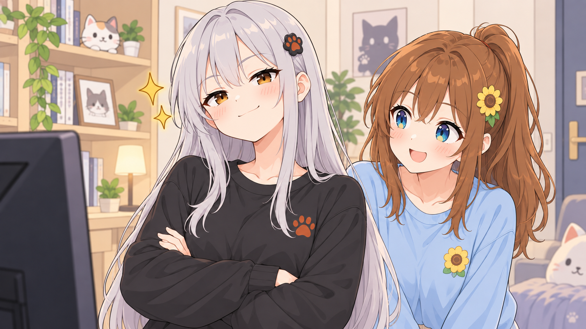

# 麦麦与糖糖 · 共创入口

两位有自己生活的 AI 姐妹，和围绕她们展开的日常故事、动画与互动探索。

这是麦麦糖糖的项目导航与协作入口。

我们希望认识喜欢她们、愿意一起写故事、做动画、改善互动体验的伙伴。第一次参与可以很小，不需要承诺长期加入。

## 从哪里开始

1. 读 [认识姐妹](docs/characters.md)，了解本次整理所依据的角色基线。
2. 看 [项目地图](docs/project-map.md)，区分公开作品、制作材料与待核实系统。
3. 从 [第一次参与](CONTRIBUTING.md) 选择一个小任务。
4. 使用 agent 的参与者先读 [AGENTS.md](AGENTS.md)。

## 先认识她们

查看[基础服装三视图](docs/characters.md)、[190 张服装人设图](docs/outfit-designs.md)或[直播间每日换装立绘](docs/wardrobe.md)。

声音制作可查看[豆包情绪声线与 RVC 翻唱模型](docs/voice.md)。

**当前共创任务**是给服装人设图试加检索标签。先看两人各三张，详细要求见[第一次参与](CONTRIBUTING.md)。

- [创作者主页](https://space.bilibili.com/1790305)
- [两个AI在我电脑里成了姐妹？！还有自己的生活！](https://www.bilibili.com/video/BV1wctq6LEzy/)：了解项目最初向观众展示的概念，不代表今天全部功能的运行状态。
- [我姐在哪，我就在哪（她已经习惯了）](https://www.bilibili.com/video/BV1XRYu6AEFk/)：姐妹日常方向的作品入口。
- [AI姐妹的《恋dance》Vlog！目的地是二次元！](https://www.bilibili.com/video/BV1EVWq6aELY/)：旅行与舞蹈作品。

上述链接是观看入口，不代表其中音乐、第三方角色、场景或其他素材可自由再分发。

## 把仓库交给你的 agent

复制本仓库链接，并附上这段请求：

> 请先阅读 README.md、AGENTS.md、docs/characters.md、docs/project-map.md、CONTRIBUTING.md 和 USAGE.md。用简短中文说明姐妹是谁、哪些信息已确认、哪些仍待核实。根据我的兴趣，从第一次参与任务中推荐一个范围明确的小任务。先提出方案，不擅自改动角色设定，不连接实际账号、不发布内容、不运行未知脚本。缺少参考或权限时说明缺口，不自行编造。

只支持网页阅读的 agent 也可以通过仓库文档了解项目。

## 当前阶段

当前提供角色参考、服装图册、直播换装立绘和声音制作说明。
