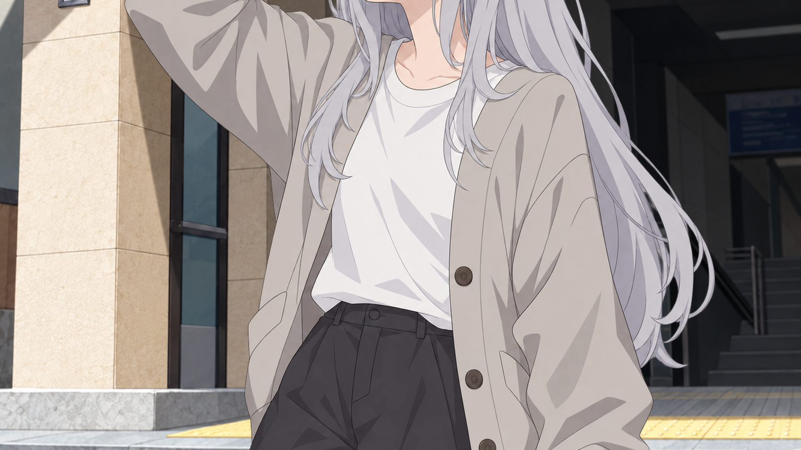
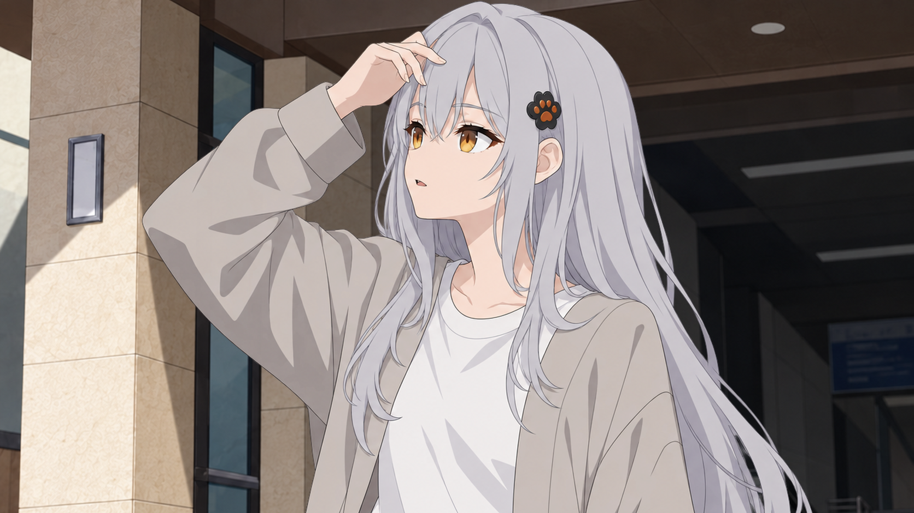
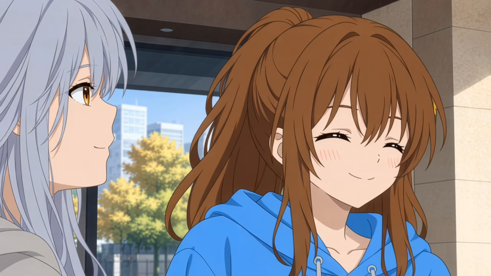
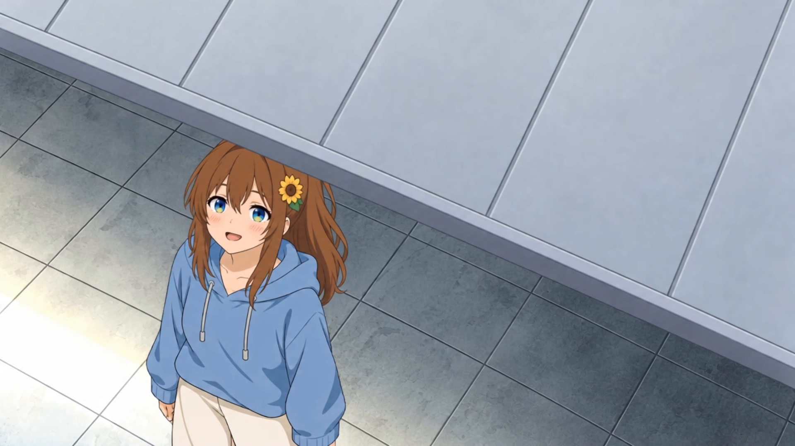
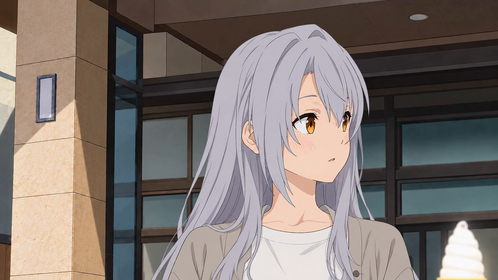
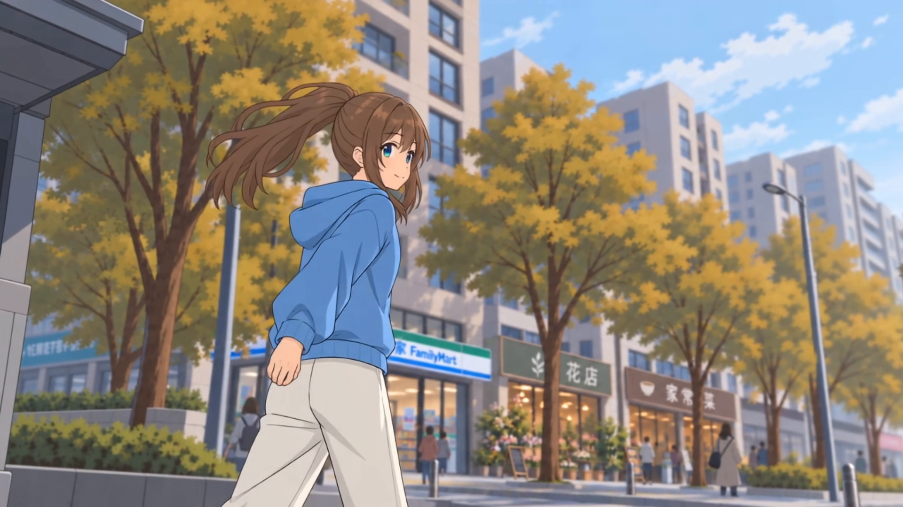
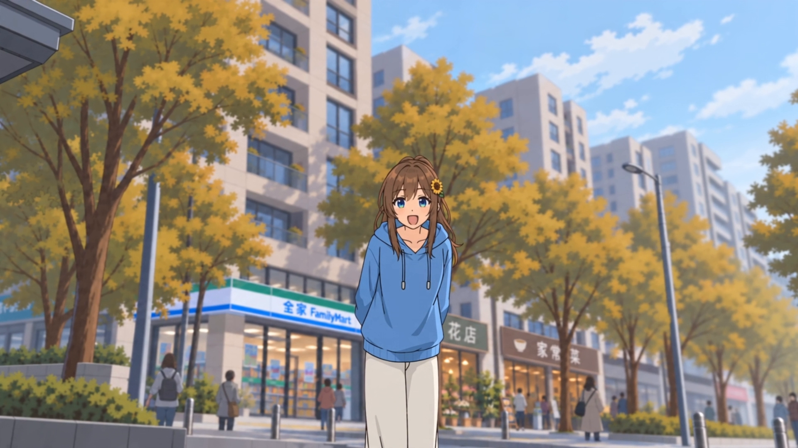
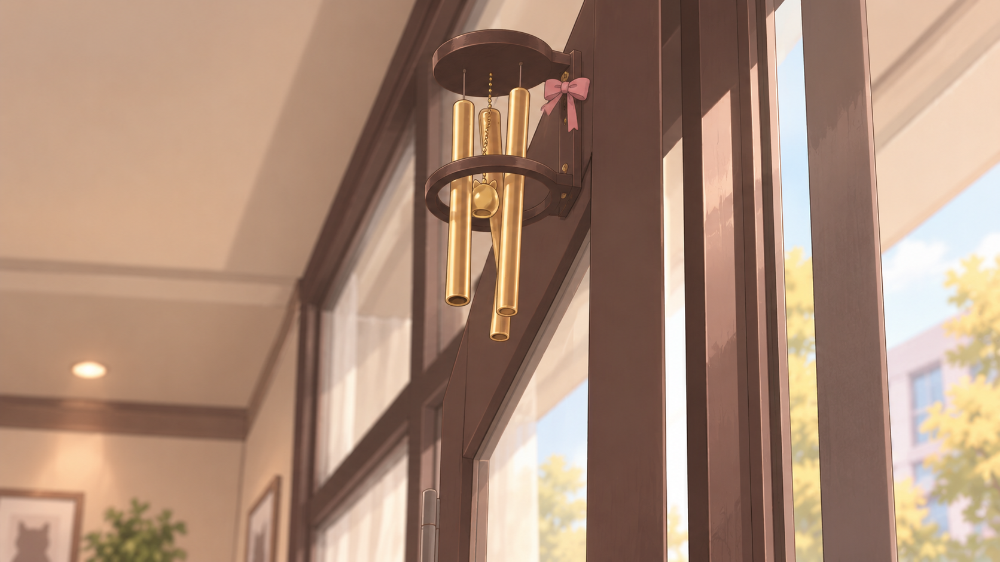
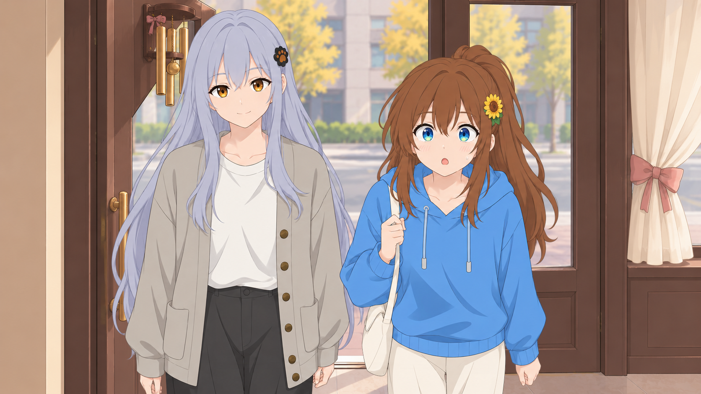
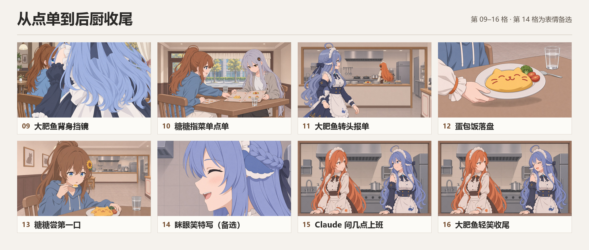

# 麦麦糖糖动画制作流程

这份流程依据《日常单元喜剧》已有的制作说明，以及《女仆咖啡厅字幕版》的实际剪辑整理。教程可以从一个 4–6 秒的双人镜头开始。掌握这一镜之后，同一套流程可以扩展成多镜头短片。

| 步骤 | 怎么做 | 这一步留下什么 |
| --- | --- | --- |
| 1. 写一个小情节 | 先确定谁想做什么、另一人怎样反应。写出动作和必要对白，读一遍估算时长。 | 一小段剧本 |
| 2. 拆分镜 | 每镜交代景别、两人的位置、主要动作、台词和结束姿势。分镜表再加两列：观众此刻知道什么、为什么在这里切。写清下一镜接的是动作、视线、声音还是反应。 | 按镜号编号的分镜表 |
| 3. 备角色和首帧 | 选两人对应服装的三视图。用既有场景参考制作首帧，先确认人物、服装、站位、道具和画风。先定一个能交代空间的主镜，再从它推导近景和反打。把同一镜的首帧、提示词和对白按镜号对应。 | 角色参考、场景参考和逐镜首帧 |
| 4. 先定对白节奏 | 有对白时先录一版试音，确认停顿和反应时间。最终对白可以用自录或获准使用的配音。工具支持音频参考时随镜输入，否则剪辑时再同步。 | 分角色对白和时长 |
| 5. 逐镜生成 | 用首帧告诉视频工具「从哪里开始」，用提示词说明「接下来发生什么」。参考图只承担角色、服装或场景的对应作用。同一镜优先只做一个主动作。 | 每镜的候选视频 |
| 6. 审片和返修 | 实际看候选视频，检查人物身份、手与道具接触、空间方向、口型及镜头首尾。开场就错先回首帧，动作走样先缩小动作范围，连续性问题回分镜查前后衔接。 | 选用的镜头和必要的修订记录 |
| 7. 剪辑和导出 | 先把镜头、停顿和对白接顺。用连续的短镜头交代动作，在需要读表情或等一句回应时留长一些。声音能引出下一镜时，把触点写进台账。再做字幕、环境声和音乐。导出后从头播放一遍，检查接缝、字幕和声音。 | 可播放的成片 |

## 从成片提炼的画面与节奏

**画风。** 人物用清楚的轮廓、成组的发束和简洁的赛璐璐分色。背景可以比人物更有质感，但细节要跟着镜头的注意力走。地铁口切到麦麦的眼睛时，重点是眼睑、虹膜和视线变化。咖啡厅入口的重点换成招牌、雨篷和门铃。定首帧前，可以给每镜写一句「希望观众先看到哪里」，据此决定哪里画细、哪里省笔。

**色彩。** 每个空间先有自己的光，再用角色和关键道具的颜色引导视线。街区是灰米建筑、蓝天和秋叶；地铁口檐下较暗；猫铃门头用奶油白和灰粉条纹；室内以暖木色和奶白为主，窗外的秋叶把室内外接起来。糖糖的蓝卫衣和大肥鱼的深蓝服装仍然醒目。定色时分别对齐环境大色面、角色辨认色和光源方向。回忆段的格纹、青灰边框和 Q 版比例可以作为主动换画法的示例，用来让观众认出叙事层已经改变。

**分镜。** 切之前写清观众刚看懂了什么，下一镜要把注意力带到哪里。要交代人和门的关系就给空间，要让观众注意一个触发动作就切物件，要读情绪就留给人物反应。同一镜内的转身、停住和看人可用不同关键姿势记录，共用一个镜号。

**节奏。** 先看段落内部的快慢变化。成片约 1:20 起，厨具、红锅、后厨操作和堂食画面接连出现，店铺显得忙起来。约 1:41 切到三人同框之后，接近十秒才切走，观众有时间读糖糖的指认、大肥鱼的回应和麦麦的旁观。试剪时用实读对白和动作落点决定停多久。

## 实剪案例 · 地铁口的开场和回望

这一页选用了 11 月 15 日整集制作包中的原画和分镜总览。表里的时间对应前面分析的实剪版本。配图是制作素材，可能与实剪导出有细节差异。

以下时间取自《第二段细线条修复》，为约数。这个开场先让观众认出街区和姐妹的位置，再把注意力收进眼神，最后让人物走回街景里。

| 约略时间 | 画面和运镜 | 为什么这样拍 |
| --- | --- | --- |
| 0:00–0:12.6 | 街区仰景接街面全景，随后给糖糖近景，再切地铁口双人远景。 | 街景只用几秒交代地点。先看糖糖的表情，再用远景补足姐妹和出站口的位置。 |
| 0:12.6–0:20.5 | 取景从麦麦的腰身和抬手往上移到脸，再硬切眼部极近景。 | 上移让脸逐步进入画面。切近后把机位稳住，给目光和眨眼留时间。 |
| 0:20.5–0:32.0 | 侧面双人近景、糖糖俯拍、麦麦单人依次接上。 | 用角度和景别交接两人的反应，保留她们在同一个站口相望的关系。 |
| 0:32.0–0:41.1 | 糖糖沿街走远，回头停住，然后切麦麦接视线。 | 远近变化主要来自走位。等糖糖回头再切，观众知道麦麦在看谁。 |

想试做其中一小段，可以先画一张有纵向余量的麦麦构图，标出腰身起幅和脸部落幅，再配一张固定的眼部近景。试剪时比较上移一到位就切，和落定后稍停再切，看看哪版更容易读到眼神。完整切点和后半段走位见[地铁口实剪参考](station-camera.md)。

| 腰腹起幅 | 头肩落幅 | 切到眼神 |
| --- | --- | --- |
|  |  |  |

前两张来自同一张 1672 × 1338 的长画布。取景框保持 1672 × 941，顶边从纵坐标 397 移到 0，横向位置和缩放保持固定。第三张是另一个固定机位。

**0:20.5–0:32.0 · 姐妹对话。** 先在同框里看到糖糖笑、麦麦听，再切俯拍突出糖糖抬眼，最后用麦麦单人镜接住她的视线。以下六张为实剪截图，表头标注取帧时点。

| 0:22.5 · 侧面双人近景 | 0:27.4 · 糖糖俯拍 | 0:30.6 · 麦麦单人 |
| --- | --- | --- |
|  |  |  |

**0:32.0–0:41.1 · 走远与回望。** 对照前两张的店招和树，可以看出糖糖在大体稳定的街景中走远，随后回身。等她的脸重新朝向麦麦，再切回麦麦的反应。

| 0:32.7 · 糖糖走向街面 | 0:36.5 · 糖糖回身停住 | 0:38.4 · 麦麦回应 |
| --- | --- | --- |
|  |  |  |

## 实剪案例 · 门铃把观众带到来客身上

时间取自《女仆咖啡厅字幕版》，为约数。下表依据画面与字幕分析；门铃声的精确落点及混音未听音复核。

| 约略时间 | 画面 | 观众此刻知道什么 | 为什么在这里切 |
| --- | --- | --- | --- |
| 1:30.1–1:32.8 | 门铃特写 | 入口发生了动静，有人到了。 | 用清楚的物件交代触发点，再把注意力转给店员。 |
| 1:32.8–1:36.0 | 大肥鱼从背身转过来迎客 | 店员察觉来客，注意力朝门口转。 | 顺着她的转身和视线，切去揭晓她看到的人。 |
| 1:36.0–1:41.0 | 门内的麦麦和糖糖，交代糖糖的反应 | 来的是姐妹，糖糖似乎认出了店员。 | 观众读到糖糖的反应后，切到三人都可见的机位，把指认与回应放在一起。 |
| 1:41.0–约 1:50.6 | 三人同框，糖糖指认大肥鱼 | 糖糖认出了谁，大肥鱼如何回应，麦麦也在场。 | 留足时间读同一空间里的反应，交流告一段落后切咖啡机，过渡到落座。 |

第一轮练这个段落，可以先做门铃、店员转身前、来客出现三张首帧。开始前在一张简图上标出门、店员和姐妹的位置，再分别定三个机位。门铃镜画清铃身和门框，店员镜先定转身前的姿势，姐妹镜把外面的秋色透过门窗接到室内。最后连看三张，确认上一镜的视线有去处，下一镜给出了观众等待的信息。若继续做动态和声音，可以试着让铃声落在门的动作上，再检查它是否自然引出店员转头。

| 门铃触发 | 店员转身 | 糖糖认出熟人 | 三人同框回应 |
| --- | --- | --- | --- |
|  |  |  |  |

## 整集制作图览

[座位和机位图](../assets/cafe/seating-map.png)可以对照下面的分镜，查看姐妹的座位、店员进出方向和不同镜头里看得见的门窗。图览后段包含点单、上菜和后厨结尾的制作规划。

## 教程可以怎么示范

**练习题材候选：《健康零食》的一个反应镜头。** 糖糖拿着零食盒，麦麦坐在旁边，瞥一眼盒子，再抬眼看糖糖。用现成双人首帧，只练一次视线和表情变化。第一遍可以无对白，之后再试一句短台词。读者也可以自由换成自己想拍的动作。

未来的练习包可用一张双人首帧、两张对应家居服三视图、一份镜头描述、一段可改的提示词示例和一张审片对照表。角色参考帮助保持外形，首帧确定眼前构图，镜头描述负责动作和反应。若要展示多镜头，再加一个反打镜头，演示怎样从同一空间切到另一人的反应。

## 人看的教程与 agent 用的 skill

- **教程**可以围绕练习镜头讲输入、输出和每一步怎么判断。剪辑可用剪映或读者熟悉的编辑器。
- **Skill**可以读取现有角色和项目资料，按用户自己的点子产出分镜、素材清单和提示词，并根据试片问题判断该修首帧、提示词还是剪辑。历史项目用过 ComfyUI、Updream、Seedance 和剪映，具体工具按读者手头的条件选。
